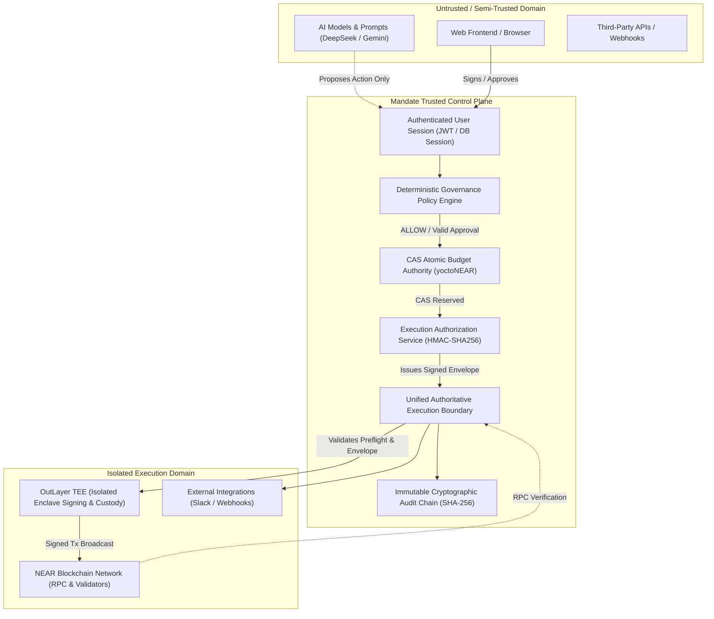

# MANDATE — MILESTONE 8: ARCHITECTURE AUDIT
## Autonomous Execution Security & Production Readiness Audit

**Audit Date:** November 2, 2026  
**Platform Version:** Mandate v1.0 (Milestones 1–7 Complete)  
**System Principle:** *"AI proposes. Mandate enforces. The user controls. OutLayer executes."*

---

### 1. Executive Summary

Milestone 7 established a deterministic Governance Engine, hierarchical policies, risk classification, cryptographically bound approvals, policy exceptions, simulation, and platform-wide enforcement. 

This audit evaluates the integrity and robustness of the **Execution Boundary**: the critical transition point where authorized intents (from specialist agents, objectives, coordination runs, human approvals, and integrations) are converted into irreversible external side effects (blockchain transfers, external API mutations, and webhook dispatches).

The audit reveals that while Mandate possesses advanced governance evaluation and optimistic CAS budget authority, the actual execution paths to external providers (primarily OutLayer TEE and third-party integrations) are currently fragmented across multiple controller routes and agent routines, with inconsistent preflight validation, lack of cryptographic execution envelopes, potential risk of early reservation release upon network timeouts, and premature transaction confirmation marking.

---

### 2. Comprehensive Inventory of Side-Effect Trigger Paths

Every path in the codebase capable of producing an external side effect was inspected:

| Path / Location | Trigger Source | Target External System | Existing Controls | Critical Vulnerabilities / Gaps |
| :--- | :--- | :--- | :--- | :--- |
| `src/app/api/approvals/route.ts:390` | Human Approver via UI | OutLayer TEE (NEAR transfer) | CAS reservation check, recipient allowlist, hash tamper check, governance policy | Falls back to mock tx hash; marks status `CONFIRMED` immediately without polling RPC; no signed execution envelope. |
| `src/app/api/tasks/route.ts:449` | AI Agent via Task API | OutLayer TEE (NEAR transfer) | Mandate active check, spending limit | **Bypasses atomic CAS reservation!** Mutates `spentYocto` directly via raw update; marks status `CONFIRMED` immediately. |
| `src/app/api/tasks/[id]/route.ts:295` | Task Action API | OutLayer TEE (NEAR transfer) | Budget check | **Bypasses `reservedYocto` accounting!** Calls OutLayer directly without CAS concurrency lock. |
| `src/lib/agent/procurementAgent.ts:511` | Autonomous Procurement Agent | OutLayer TEE (NEAR transfer) | Mandate allowlist, budget threshold | Calls `executeOutlayerTransfer` directly; no preflight RPC balance check. |
| `src/app/api/wallets/withdraw/route.ts:114` | User Withdrawal | OutLayer TEE (NEAR transfer) | Stored balance check | Calls `executeOutlayerTransfer` without pre-execution validation of network fee/gas. |
| `src/lib/coordination/financialCoordinator.ts:197` | Multi-Agent Coordination Run | OutLayer TEE / Custody Vault | CAS reservation, policy check | **Catches any error and immediately releases reservation**, risking double spend if RPC timed out post-broadcast. |
| `src/lib/integrations/adapters/nearAdapter.ts:229` | Tool / Integration Executor | OutLayer TEE (NEAR transfer) | Permission service check | Direct call to OutLayer; fallback to `"mock-api-key"`. |
| `src/lib/tools/executor.ts:317` | Specialist Agents / Tool Registry | Slack, Webhooks, Search, REST APIs | Rate limiter, permission level, schema validation, policy check | No cryptographic execution authorization envelope between policy evaluation and execution. |

---

### 3. Trust Boundaries & Component Analysis

#### Trust Boundary Rules:
1. **Model Isolation**: LLMs and AI agents propose actions; they never hold custody of private keys, API secrets, or execution signing authority.
2. **Authority Isolation**: Authorization is determined solely by deterministic code in the Mandate control plane, verified by cryptographically bound human approval when required.
3. **Execution Separation**: External side effects must be dispatched solely through the unified execution boundary; direct invocations of OutLayer or external adapters from agents or unverified endpoints are strictly prohibited.
4. **TEE Boundary**: OutLayer executes NEAR transactions within an isolated enclave using an API key securely stored in the Mandate database, never exposed to agents or frontend clients.

---

### 4. Identified Vulnerabilities & Architectural Gaps

1. **Fragmentation of Execution**: Six independent locations call `executeOutlayerTransfer` with differing levels of validation and state updates.
2. **Missing Execution Authorization Envelope**: No cryptographic envelope exists between policy evaluation/approval and execution. Any internal routine with access to the database or wallet API key could invoke transfers without presenting verifiable proof of authorization.
3. **Fragile Timeout Handling (Early Reservation Release)**: In `financialCoordinator.ts`, catch blocks immediately release the budget reservation upon error. If an RPC call times out after being broadcast to the NEAR network, releasing the reservation allows subsequent transactions to double-spend the budget while the broadcast transaction confirms on-chain.
4. **Premature Confirmation Lifecycle**: Transactions are frequently marked `CONFIRMED` upon receiving a positive response from the OutLayer HTTP endpoint, rather than maintaining a strict lifecycle (`VALIDATED` $\rightarrow$ `AUTHORIZED` $\rightarrow$ `SIGNED` $\rightarrow$ `BROADCAST` $\rightarrow$ `CONFIRMED`).
5. **Incomplete Preflight Validation**: Transfers are dispatched without verifying recipient account format, on-chain account existence, minimum storage balance, and network availability.
6. **Incomplete Audit Event Coverage**: The SHA-256 audit ledger records general events but lacks granular execution lifecycle transitions (`EXECUTION_PROPOSED`, `EXECUTION_AUTHORIZED`, `TRANSACTION_BROADCAST`, etc.).

---

### 5. Architectural Recommendations for Milestone 8

1. **Create `ExecutionBoundaryService`**: A single, authoritative, non-bypassable entry point for all external side effects.
2. **Implement `ExecutionAuthorizationService`**: Generate and verify tamper-proof HMAC-SHA256 authorization envelopes with single-use nonces, parameter binding, and short TTLs.
3. **Implement `ExecutionValidationService`**: Pure deterministic preflight validation for NEAR transfers (exact yoctoNEAR arithmetic, recipient format, gas/storage reserves).
4. **Harden Idempotency & Replay Protection**: Persist execution records with request payload hashes; detect parameter tampering across repeated requests.
5. **Implement Safe Failure Recovery & Polling**: Never release a reservation on ambiguous network timeouts. Transition to `REQUIRES_RECOVERY` and poll NEAR RPC.
6. **Extend Audit Ledger**: Add all 14 execution lifecycle event types to the tamper-evident SHA-256 hash chain.

