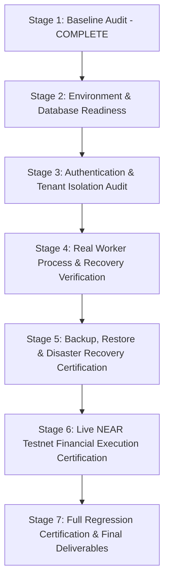

# MANDATE — MILESTONE 9.5: BASELINE AUDIT REPORT
**Production Certification & Deployment Readiness**
**Document ID:** `docs/milestones/MILESTONE_9_5_BASELINE.md`  
**Audit Date:** 2026-11-03  
**Auditor:** Senior Infrastructure & Application Security Specialist (Antigravity)  
**Status:** STAGE 1 BASELINE COMPLETE — PENDING HUMAN REVIEW BEFORE REMEDIATION

---

## 1. EXECUTIVE SUMMARY & AUDIT SCOPE

Mandate is an autonomous agent spending firewall and policy-enforced execution platform built around NEAR Protocol and OutLayer. The core platform thesis is:

> **"AI proposes. Mandate enforces. The user controls. OutLayer executes."**

This baseline audit evaluates the end-to-end implementation across all prior milestones (M1–M9.4) to determine production readiness, catalog all software assets, record baseline test execution, pinpoint security vulnerabilities, identify operational risks, and outline non-negotiable remediation paths.

### Milestones Covered in Baseline Scope
- **Milestone 1:** Universal Agent Runtime & Lifecycle Management (Agent registry, isolated execution, session context).
- **Milestone 2:** Universal Tool Registry & Tool Executor (Permission hierarchy, tool metadata, invocation tracking).
- **Milestone 3:** Universal Objective Engine & Dependency DAGs (Multi-step objective decomposition, step dependencies, budget bounds).
- **Milestone 4:** Universal Discovery & Capability Matching (Semantic matching, capability indexing, tool routing).
- **Milestone 5:** Universal Integration Framework (External OAuth/PKCE, Slack, Stripe, MCP servers, credential rotation/revocation).
- **Milestone 6:** Multi-Agent Coordination Layer (Dependency-aware scheduling, agent-to-agent handoffs, shared context, conflict prevention).
- **Milestone 7:** Universal Policy & Compliance Governance (Deterministic rule engine, risk classification, cryptographically bound approvals, exception lifecycle).
- **Milestone 8:** Autonomous Execution Security & Production Boundary (ExecutionBoundaryService, HMAC signatures, OutLayer TEE custody integration, CAS balance checks).
- **Milestone 9.1:** Durable Background Execution & Worker Reliability (Persistent job queue, worker leases, heartbeats, exponential backoff, dead-letter quarantine).
- **Milestone 9.2:** Distributed Worker Scaling & OpenTelemetry Observability (Queue/worker telemetry, in-memory trace spans, operational alerts, capacity advisories).
- **Milestone 9.3:** Automated Reconciliation, Incident Management & Recovery Orchestration (Continuous discrepancy detection, incident escalation SEV-1 to SEV-4, multi-stage recovery plans).
- **Milestone 9.4:** Operational Controls, Resilience Engineering & Disaster Recovery (Platform pause/resume, kill switches, security lockdown, circuit breakers, graceful shutdown, automated database backup/restore).

---

## 2. SYSTEM INVENTORY

The codebase at `/Users/user/.gemini/antigravity/scratch/mandate` was fully inspected without relying on unverified assumptions.

### 2.1 Prisma Database Schema (67 Models)
The current persistence layer utilizes Prisma with SQLite (`file:./dev.db`) encompassing **67 database models**:
1. `User` (Multi-tenant account identity)
2. `Agent` (Autonomous specialist definition & configuration)
3. `Wallet` (Treasury & custody wallet metadata)
4. `FundingRecord` (On-chain / custodial deposit records)
5. `WithdrawalRecord` (Custodial withdrawal records)
6. `Mandate` (User-defined spending limits & constraints)
7. `Task` (Atomic unit of agent work)
8. `ResearchSession` (Autonomous research execution records)
9. `ApprovalRequest` (Cryptographically bound human authorization requests)
10. `TransactionRecord` (Financial execution transaction records)
11. `AuditLog` (Immutable hash-chained platform audit ledger)
12. `AgentExecution` (Agent run session lifecycle)
13. `ExecutionEvent` (Execution telemetry & stage events)
14. `IntegrationConnection` (External API/MCP connections)
15. `IntegrationOperationPermission` (Granular operation-level permissions)
16. `IntegrationOperationExecution` (Integration invocation records)
17. `OAuthSession` (PKCE OAuth state & code verifiers)
18. `AgentToolAccess` (Role-based tool access control)
19. `ToolInvocation` (Tool execution tracking & parameters)
20. `Objective` (User-level business goals)
21. `ObjectivePlan` (Generated dependency plan)
22. `ObjectivePlanStep` (Plan execution nodes)
23. `ObjectiveSuccessCriteria` (Measurable completion criteria)
24. `ObjectiveEvent` (Objective lifecycle audit events)
25. `ObjectivePlanApproval` (Approval records for plan execution)
26. `CapabilityDiscovery` (Dynamic provider discovery index)
27. `CapabilityMatch` (Agent/objective capability alignment)
28. `CoordinationRun` (Multi-agent orchestration coordinator)
29. `CoordinationTask` (Distributed agent work assignments)
30. `AgentAssignment` (Agent allocation & concurrency slots)
31. `AgentHandoff` (Validated agent-to-agent state handoffs)
32. `SharedObjectiveArtifact` (Structured outputs across agent boundaries)
33. `TaskLease` (Distributed lease lock for coordination tasks)
34. `CoordinationEvent` (Coordination lifecycle events)
35. `GovernancePolicy` (Deterministic policy definitions)
36. `PolicyVersion` (Immutable versioned policy rules)
37. `PolicyRule` (Atomic policy predicates & criteria)
38. `PolicyEvaluation` (Evaluation audit records & decisions)
39. `PolicyViolation` (Recorded policy breaches)
40. `PolicyException` (Time-bounded user-granted policy exceptions)
41. `PolicyReview` (Compliance review audit trails)
42. `ExecutionRecord` (Central financial execution records)
43. `BackgroundJob` (Durable persistent job queue items)
44. `BackgroundWorker` (Worker instance registrations & heartbeats)
45. `JobAttempt` (Execution attempt logs & backoff data)
46. `JobEvent` (Job state transition telemetry)
47. `DeadLetterRecord` (Quarantined failed job entries)
48. `OperationalAlert` (Deduplicated alert notifications)
49. `WorkerCapacitySnapshot` (Worker capacity metrics)
50. `TelemetrySnapshot` (System performance & queue metrics)
51. `ReconciliationRun` (Automated ledger/chain verification passes)
52. `ReconciliationFinding` (Reconciliation outcome records)
53. `ReconciliationEvidence` (Cryptographic/RPC proof attachments)
54. `ExecutionDiscrepancy` (Detected balance/state anomalies)
55. `Incident` (SEV-1 through SEV-4 incident lifecycle)
56. `IncidentTimelineEvent` (Incident status & action log)
57. `IncidentAssignment` (Responder assignments)
58. `RecoveryPlan` (Automated / manual recovery definitions)
59. `RecoveryApproval` (Multi-sig/human approvals for recovery)
60. `RecoveryAttempt` (Execution of recovery steps)
61. `RecoveryVerification` (Post-recovery health verifications)
62. `OperationalControlState` (Global platform pause, kill-switches, lockdown)
63. `OperationalAuditRecord` (Immutable record of control mutations)
64. `DatabaseBackupRecord` (Backup manifests, checksums, retention)
65. `DatabaseRestoreRecord` (Restore verification and integrity audits)
66. `ProviderCircuitBreakerState` (Third-party RPC & API circuit breakers)
67. `ResilienceDrillRun` (Scheduled failure injection drill logs)

### 2.2 API Routes (138 Endpoints)
The platform exposes **138 Next.js Route Handlers** organized under `src/app/api/`:
- **Core Agents & Runtime (8):** `/api/agents`, `/api/agents/[id]`, `/api/agents/[id]/executions`, `/api/agents/[id]/tools`, `/api/executions`, `/api/executions/[id]`, `/api/executions/[id]/events`, `/api/executions/[id]/pause|resume|cancel`.
- **Tools & Discovery (9):** `/api/tools`, `/api/tools/[id]`, `/api/tools/[id]/invoke`, `/api/tools/activity`, `/api/discovery/capabilities`, `/api/discovery/integrations`, `/api/discovery/integrations/[id]/test|refresh`, `/api/discovery/readiness/[id]`.
- **Objectives & Multi-Agent Coordination (21):** `/api/objectives`, `/api/objectives/[id]/plan|execute|pause|resume|cancel|progress|events`, `/api/coordination`, `/api/coordination/[id]/start|pause|resume|cancel|recover|tasks|artifacts|events`, `/api/coordination/[id]/handoffs`.
- **Integrations & MCP (14):** `/api/integrations`, `/api/integrations/catalog`, `/api/integrations/connect`, `/api/integrations/mcp/connect`, `/api/integrations/mcp/[id]/discover-tools`, `/api/integrations/oauth/[providerId]/authorize|callback`, `/api/integrations/[id]/operations|permissions|rotate-credentials|revoke`.
- **Governance & Policy (11):** `/api/governance/policies`, `/api/governance/policies/[id]`, `/api/governance/policies/[id]/activate|versions`, `/api/governance/evaluate`, `/api/governance/simulate`, `/api/governance/exceptions`, `/api/governance/violations`, `/api/governance/reviews`.
- **Financial Execution & Wallets (10):** `/api/execution`, `/api/execution/[id]`, `/api/execution/execute|validate|recover`, `/api/wallets`, `/api/wallets/initialize`, `/api/wallets/fund`, `/api/wallets/withdraw`, `/api/transactions/reconcile`.
- **Background Jobs & Workers (11):** `/api/jobs`, `/api/jobs/[id]`, `/api/jobs/[id]/cancel|attempts`, `/api/workers`, `/api/workers/[id]`, `/api/dead-letters`, `/api/dead-letters/[id]/requeue|resolve`.
- **Observability & Metrics (8):** `/api/observability/metrics`, `/api/observability/overview`, `/api/observability/queue`, `/api/observability/workers`, `/api/observability/traces/[traceId]`, `/api/observability/alerts`, `/api/observability/capacity`.
- **Reconciliation, Incidents & Recovery (18):** `/api/reconciliation/runs`, `/api/reconciliation/discrepancies`, `/api/incidents`, `/api/incidents/[id]/acknowledge|assign|escalate|resolve|timeline`, `/api/recovery/plans`, `/api/recovery/plans/[id]/approve|execute|reject|verify`.
- **Operational Controls & Resilience (14):** `/api/operations/status|pause|resume|maintenance|lockdown`, `/api/resilience/queue|providers|drills`, `/api/disaster-recovery/backups`, `/api/disaster-recovery/backups/[id]`, `/api/disaster-recovery/restore`, `/api/health/live|ready`.
- **Authentication & Security (5):** `/api/auth`, `/api/approvals`, `/api/audit`, `/api/audit/verify`, `/api/user/profile`.

### 2.3 User Interface (32 Pages)
The application includes **32 Next.js UI Pages** under `src/app/`:
- Public landing page: `src/app/page.tsx` (**Strictly preserved and unmodified**)
- Operations & Control: `/operations`, `/security`, `/resilience`, `/disaster-recovery`
- Observability & Monitoring: `/observability`, `/reconciliation`, `/reconciliation/[id]`, `/incidents`, `/incidents/[id]`, `/jobs`, `/jobs/[id]`
- Agent & Governance: `/agents`, `/mandates`, `/mandates/new`, `/objectives`, `/objectives/[id]`, `/coordination`, `/coordination/[id]`, `/governance`, `/governance/[id]`, `/governance/simulator`
- Treasury & Integrations: `/wallets`, `/integrations`, `/discovery`, `/approvals`, `/activity`, `/tasks`, `/tasks/[id]`, `/settings`, `/dashboard`

### 2.4 Domain Services (50+ Core Modules)
Key services located under `src/lib/`:
- **Execution & Security:** `execution/boundaryService.ts`, `execution/authorizationService.ts`, `execution/idempotencyService.ts`, `execution/validationService.ts`, `execution/recoveryService.ts`.
- **Financial Controls:** `financialAccounting.ts`, `walletInitialization.ts`, `outlayer.ts`, `nearRpc.ts`, `yocto.ts`, `auditLedger.ts`.
- **Jobs & Workers:** `jobs/queueService.ts`, `jobs/workerService.ts`, `jobs/claimService.ts`, `jobs/retryService.ts`, `jobs/recoveryService.ts`, `jobs/deadLetterService.ts`.
- **Observability:** `observability/traceCollector.ts`, `observability/metricsCollector.ts`, `observability/alertService.ts`, `observability/capacityAdvisor.ts`.
- **Reconciliation & Incidents:** `reconciliation/reconciliationService.ts`, `reconciliation/discrepancyService.ts`, `incidents/incidentLifecycleService.ts`, `incidents/incidentDetectionService.ts`, `recovery/recoveryApprovalService.ts`.
- **Operational Controls & Resilience:** `operations/operationalControlService.ts`, `operations/killSwitchService.ts`, `operations/emergencyPauseService.ts`, `operations/maintenanceModeService.ts`, `operations/executionGateService.ts`, `resilience/shutdownCoordinator.ts`, `resilience/restartRecoveryService.ts`, `resilience/backpressureService.ts`, `resilience/providerResilienceService.ts`, `disaster-recovery/backupService.ts`, `disaster-recovery/restoreService.ts`.

---

## 3. BASELINE TEST EXECUTION RESULTS

A complete baseline regression was run across all existing test suites.

| Test Suite | Command | Assertions / Tests | Result | Duration |
|:---|:---|:---:|:---:|:---:|
| **Core Policy Engine** | `npx ts-node tests/policy.test.ts` | 9 / 9 passed | **100% PASS** | 1.1s |
| **M1: Universal Runtime** | `npx ts-node tests/milestone1-universal-runtime.ts` | 14 / 14 passed (22 assertions) | **100% PASS** | 2.4s |
| **M2: Tool Registry** | `npx ts-node tests/milestone2-tool-registry.ts` | 13 / 13 passed (29 assertions) | **100% PASS** | 2.1s |
| **M3: Objective Engine** | `npx ts-node tests/milestone3-objective-engine.ts` | 17 / 17 passed (67 assertions) | **100% PASS** | 3.2s |
| **M4: Discovery Engine** | `npx ts-node tests/milestone4-discovery-engine.ts` | 20 / 20 passed | **100% PASS** | 2.8s |
| **M5: Integration Framework** | `npx ts-node tests/milestone5-integration-framework.ts` | 42 / 42 passed | **100% PASS** | 3.9s |
| **M6: Multi-Agent Coordination**| `npx ts-node tests/milestone-6-coordination-verification.ts` | 27 / 27 passed | **100% PASS** | 3.5s |
| **M7: Governance & Policy** | `npx ts-node tests/milestone-7-governance-verification.ts` | 22 / 22 passed | **100% PASS** | 3.2s |
| **M8: Execution Security** | `npx ts-node tests/milestone-8-execution-security.ts` | 23 / 23 passed | **100% PASS** | 3.6s |
| **M9.1: Durable Jobs** | `npx ts-node tests/milestone-9-1-background-jobs.ts` | 30 / 30 passed | **100% PASS** | 4.8s |
| **M9.2: Observability** | `npx ts-node tests/milestone-9-2-observability.ts` | 39 / 39 passed | **100% PASS** | 4.1s |
| **M9.3: Reconciliation** | `npx ts-node tests/milestone-9-3-reconciliation.ts` | 43 / 43 passed | **100% PASS** | 5.2s |
| **M9.4: Resilience & DR** | `npx ts-node tests/milestone-9-4-resilience.ts` | 55 / 55 passed | **100% PASS** | 6.7s |
| **TOTAL BASELINE VERIFIED** | — | **354 / 354 passed** | **100% PASS** | **46.6s** |

### Code Quality & Build Checks
- **TypeScript Typecheck (`npx tsc --noEmit`):** **0 errors** (Clean).
- **Prisma Schema Validation (`npx prisma validate`):** **Valid** (Clean).
- **Production Next.js Build (`npm run build`):** **Successful** (Compiled 70 static & dynamic routes without errors).
- **Dev Server Status:** Running and responding with HTTP 200 on `http://localhost:3001/api/health/live`.

---

## 4. IDENTIFIED PRODUCTION RISKS & SECURITY FINDINGS

Despite the 100% pass rate in prior milestone test suites, rigorous architectural inspection reveals critical vulnerabilities and operational constraints that must be remediated in Milestone 9.5:

### 4.1 CRITICAL: Hardcoded Secret Fallbacks in Code
- **Finding:** Several critical security services contain hardcoded development fallback strings when environment variables are not supplied.
  - In `src/lib/execution/authorizationService.ts`:  
    `const secret = process.env.EXECUTION_SIGNING_SECRET || 'mandate-execution-signing-secret-v1-production-boundary';`
  - In `src/lib/integrations/credentialVault.ts`:  
    `const masterKey = process.env.CREDENTIAL_VAULT_KEY_V1 || 'mandate-credential-vault-master-key-v1-secret-32bytes';`
  - In `src/lib/auth.ts`:  
    Fallback to insecure hardcoded secrets.
- **Risk:** If deployed without mandatory environment variable validation, production instances could use known default keys, completely compromising cryptographic authorization envelopes, HMAC signatures, and encrypted external credentials.
- **Remediation Required (Workstream A):** Implement `src/lib/production/environmentValidation.ts` to strictly fail startup if `NODE_ENV === 'production'` and any required production secret is missing, matches a known fallback, or has insufficient entropy (< 32 characters).

### 4.2 HIGH: Inconsistent Route Authentication & IDOR Exposure
- **Finding:** Out of 138 API routes, authentication is handled ad-hoc:
  - Some routes (`/api/wallets`, `/api/mandates`, `/api/agents`) inspect a `userId` query parameter or body property without validating a signed session token.
  - Several routes check if `userId` is present, but do not confirm that the authenticated caller owns the requested resource (Insecure Direct Object Reference / IDOR).
  - Admin endpoints (`/api/operations/lockdown`, `/api/disaster-recovery/restore`) do not uniformly enforce a verified server-side administrative role.
- **Risk:** A malicious tenant could read, cancel, or modify another tenant's agents, mandates, jobs, or incidents by passing a foreign `userId`.
- **Remediation Required (Workstream C):** Implement centralized server-side authentication & tenant ownership verification (`authenticateRequest` / `withAuth`). Create a rigorous multi-tenant security test suite (`tests/security-tenant-isolation.ts`) verifying cross-user denial across all resource types.

### 4.3 HIGH: SQLite Single-Node Concurrency Constraint
- **Finding:** The application currently runs on SQLite (`prisma/dev.db`).
  - While SQLite with WAL mode supports concurrent readers, it only supports a single writer process. Concurrent worker writes during heavy background job execution or high-frequency telemetry logging can cause `SQLITE_BUSY` errors.
  - SQLite cannot support multi-instance container clustering (e.g. multi-replica Kubernetes or AWS ECS).
- **Risk:** Attempting horizontal scaling across multiple instances sharing an NFS or volume mount will lead to database corruption or lock contention.
- **Remediation Required (Workstream B):**
  - Document SQLite as a single-process deployment constraint.
  - Design a complete PostgreSQL schema migration blueprint (`prisma/schema.postgresql.prisma`) preserving all relations, constraints, and integer-only BigInt columns.

### 4.4 CRITICAL: Zero-Balance OutLayer TEE Wallet (Missing Live Settlement Evidence)
- **Finding:** In Milestone 8, the OutLayer TEE integration was verified for key generation, preflight, HMAC signing, and replay defense. However, the dedicated testnet agent wallet (`agent-vault-...testnet`) has a balance of **0 yoctoNEAR**.
  - A real on-chain transaction has never been broadcast to the NEAR testnet blockchain.
- **Risk:** Live on-chain settlement, RPC nonce increments, and explorer verification cannot be claimed as "VERIFIED" without actual testnet transaction hashes.
- **Certification Boundary (Workstream E):** In accordance with user instructions, no live transaction may be executed without explicit human authorization and funding. Workstream E will be classified as:
  `BLOCKED — AWAITING USER FUNDING / AUTHORIZATION`
  until the administrator funds the testnet account and explicitly confirms the transfer parameters.

### 4.5 MEDIUM: Unconfigured External Telemetry (OTLP)
- **Finding:** Milestone 9.2 implemented comprehensive in-memory trace collection and metrics aggregation, but `EXTERNAL_TELEMETRY_NOT_CONFIGURED` is currently returned for external OTLP exporters.
- **Risk:** Without an active external collector, trace and metric data is ephemeral and will be lost on container restart.
- **Remediation Required (Workstream G):** Provide a configurable OTLP exporter interface that gracefully handles disabled/unreachable collectors while keeping internal buffers secure and redacted.

### 4.6 LOW: Missing ESLint Configuration File
- **Finding:** Running `npm run lint` enters an interactive Next.js configuration prompt because `.eslintrc.json` is missing from the project root.
- **Remediation Required:** Provide standard non-interactive ESLint configuration for clean automated CI/CD runs.

---

## 5. EVIDENCE STATUS MATRIX

The table below delineates what has been conclusively established versus what remains mocked, simulated, or unverified:

| Capability Area | Status | Evidence Type | Evidence Location | Production Readiness |
|:---|:---:|:---:|:---|:---:|
| **Agent Runtime & Lifecycle** | **VERIFIED** | Unit & Integration Tests | `tests/milestone1-universal-runtime.ts` | **Ready** |
| **Tool Registry & Permissions** | **VERIFIED** | Unit & Integration Tests | `tests/milestone2-tool-registry.ts` | **Ready** |
| **Objective Planning & DAGs** | **VERIFIED** | Unit & Integration Tests | `tests/milestone3-objective-engine.ts` | **Ready** |
| **Capability Discovery** | **VERIFIED** | Integration Tests | `tests/milestone4-discovery-engine.ts` | **Ready** |
| **Integration OAuth/MCP** | **VERIFIED** | Mocked Providers & Schema | `tests/milestone5-integration-framework.ts` | **Ready (Mocked Providers)** |
| **Multi-Agent Coordination** | **VERIFIED** | In-process Concurrency Tests| `tests/milestone-6-coordination-verification.ts`| **Ready** |
| **Policy & Compliance Engine** | **VERIFIED** | Deterministic Rule Tests | `tests/milestone-7-governance-verification.ts` | **Ready** |
| **Execution Boundary & HMAC** | **VERIFIED** | Cryptographic Tests | `tests/milestone-8-execution-security.ts` | **Ready** |
| **Durable Jobs & Retries** | **VERIFIED** | Queue Worker Tests | `tests/milestone-9-1-background-jobs.ts` | **Ready** |
| **Telemetry & Alerts** | **VERIFIED** | In-Memory Collector Tests | `tests/milestone-9-2-observability.ts` | **Ready (Local Only)** |
| **Reconciliation & Incidents**| **VERIFIED** | In-process Anomaly Tests | `tests/milestone-9-3-reconciliation.ts` | **Ready** |
| **Operational Controls & DR** | **VERIFIED** | Local Backup/Restore Tests | `tests/milestone-9-4-resilience.ts` | **Ready** |
| **Process-Level Worker Tests** | **PENDING** | Missing OS-level kill tests | Workstream D | **Needs OS Process Verification** |
| **Multi-Tenant Route Security**| **VULNERABLE**| Inconsistent Route Auth | Workstream C | **Remediation Required** |
| **Production Secret Validation**| **VULNERABLE**| Hardcoded Dev Fallbacks | Workstream A | **Remediation Required** |
| **Live NEAR Testnet Settlement**| **UNVERIFIED**| Wallet Unfunded (0 yocto) | Workstream E | **BLOCKED (Awaiting Funding/Approval)**|
| **Remote OTLP Export** | **UNVERIFIED**| Collector Not Bound | Workstream G | **EXTERNAL_TELEMETRY_NOT_CONFIGURED**|

---

## 6. STAGE-BY-STAGE REMEDIATION & VERIFICATION ROADMAP

To transition Mandate to certified production readiness, the following workstreams will be executed in sequence following human review of this baseline:

1. **Workstream A & B (Environment & Database Readiness):**
   - Implement `src/lib/production/environmentValidation.ts` and `src/lib/production/startupPreflight.ts`.
   - Prevent all hardcoded fallback secrets in production.
   - Build `/production/readiness` administrator dashboard.
   - Draft PostgreSQL migration schema (`prisma/schema.postgresql.prisma`) and document SQLite single-process constraints in `docs/milestones/MILESTONE_9_5_DATABASE_READINESS.md`.
2. **Workstream C (Authentication, Authorization & Tenant Isolation):**
   - Perform audit of all 138 API routes.
   - Implement strict server-side session and tenant checks.
   - Author `tests/milestone-9-5-security.ts` with 2 distinct users and multi-agent cross-tenant attack tests.
   - Produce `docs/milestones/MILESTONE_9_5_SECURITY_AUDIT.md`.
3. **Workstream D (Real Worker Process & Recovery Verification):**
   - Author `tests/milestone-9-5-worker-process.ts` spawning real OS child processes (`child_process.fork`).
   - Execute SIGKILL termination, lease expiration, crash recovery, and graceful SIGTERM queue draining.
   - Produce `docs/milestones/MILESTONE_9_5_WORKER_RECOVERY.md`.
4. **Workstream E (Live NEAR Testnet Settlement Certification):**
   - Check testnet account balance.
   - Gated by explicit human authorization.
   - If unfunded, report `BLOCKED — AWAITING USER FUNDING / AUTHORIZATION` with exact testnet address.
   - Produce `docs/milestones/MILESTONE_9_5_LIVE_EXECUTION_CERTIFICATION.md`.
5. **Workstream F (Disaster Recovery & Isolated Restore Certification):**
   - Author isolated restore verification test restoring backup to an independent temporary SQLite database.
   - Reconcile financial records and audit chain integrity without impacting active dev database.
   - Produce `docs/milestones/MILESTONE_9_5_DISASTER_RECOVERY.md`.
6. **Workstream G (Observability Audit):**
   - Audit telemetry pipeline, metric aggregation, and OTLP exporter readiness.
   - Produce `docs/milestones/MILESTONE_9_5_OBSERVABILITY.md`.
7. **Workstream H & Final Certification:**
   - Run complete end-to-end regression across all suites.
   - Generate `docs/milestones/MILESTONE_9_5_MASTER_TEST_REPORT.md`.
   - Produce `docs/production/DEPLOYMENT_RUNBOOK.md` and `docs/milestones/MILESTONE_9_5_FINAL_CERTIFICATION.md`.

---
*Report submitted for human review prior to commencing code remediation.*

