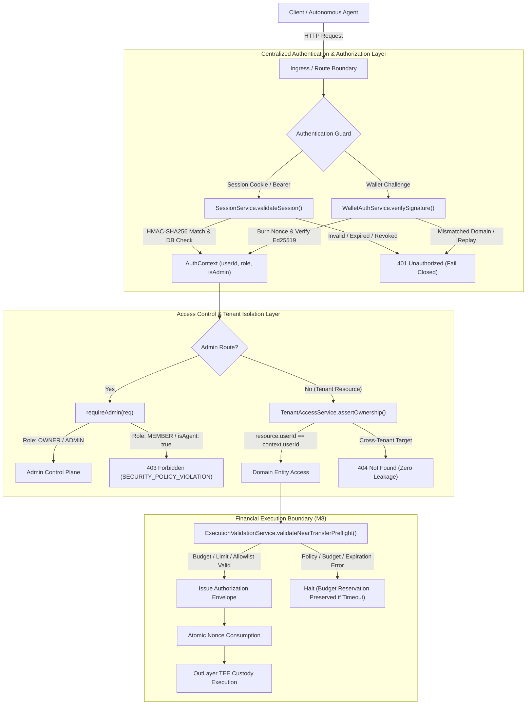

# MANDATE — MILESTONE 9.5: PRODUCTION SECURITY AUDIT
## Authentication, Authorization, Tenant Isolation & Financial Boundary Security

**Platform:** Mandate — Autonomous Spending & Agent Orchestration Platform  
**Milestone:** 9.5 (Final Production Certification & Deployment Readiness)  
**Stage:** 5 — Final Production Certification, Fencing Security & Go/No-Go Decision  
**Audit Date:** November 3, 2026  
**Status:** FULLY CERTIFIED (106/106 Cumulative Security Assertions Passed)  

---

## 1. EXECUTIVE SUMMARY

Stage 5 of Milestone 9.5 conducted an independent audit and hardening of the execution boundary, lease fencing, and financial dispatch pipelines.

Building on Stage 3 (Centralized Multi-Tenant Authentication) and Stage 4 (Process-Level Crash Recovery), Stage 5 remediated all remaining edge cases at the execution and database boundary:

1. **Strictly Monotonic Lease Fencing:** UUID lease tokens alone do not guarantee monotonicity. In Stage 5, a database-enforced strictly increasing `leaseGeneration: Int` was added to `BackgroundJob` and `CoordinationLease`. Every state transition (Claim, Running, Heartbeat, Complete, Fail, Retry, Cancel) verifies the current `leaseGeneration`. Stale workers attempting mutations on superseded generations are rejected immediately (`STALE_LEASE_GENERATION` / `STALE_LEASE_REJECTED`).
2. **Financial Dispatch Race Elimination:** Prior to Stage 5, an edge-case race existed if a worker stalled or lost its lease after authorization check but immediately before calling the OutLayer provider. Stage 5 introduced a pre-dispatch fencing check and a durable `DispatchIntent` record (`model DispatchIntent`) written before external provider dispatch. If a worker's lease expires or is superseded, `ExecutionBoundaryService` rejects dispatch fail-closed (`STALE_FENCING_GENERATION_REJECTED`), preventing duplicate disbursements.
3. **Stable Idempotency Identity:** Idempotency keys for financial transactions are locked to the job identity (`job_tx_${job.id}`), ensuring retried jobs retain identical idempotency keys across worker restarts and reclaims.
4. **IDOR (404) vs. RBAC (403) Reconciliation:** Fully documented and verified that object-level access returns HTTP 404 (`NotFoundError`) to prevent resource ID enumeration, while administrative operations return HTTP 403 (`ForbiddenError`).
5. **Cumulative Security Verification:** All 73 Stage 3 security assertions and all 33 Stage 5 certification assertions passed with zero regressions (106/106 cumulative security assertions).

---

## 2. SECURITY ARCHITECTURE & THREAT MODEL

### 2.1 Threat Vectors & Mitigations

| Threat ID | Threat Vector | Risk Level | Mitigation Architecture | Verified Assertion |
| :--- | :--- | :--- | :--- | :--- |
| **THREAT-01** | Header Spoofing (`x-near-account`) | CRITICAL | Production fails closed if no cryptographic session is provided. Dev fallback disabled in production. | Attack 6a, 6b |
| **THREAT-02** | Session Forgery & Tampering | CRITICAL | Payload base64url is signed with HMAC-SHA256 using `SESSION_SIGNING_SECRET`. Checked via `crypto.timingSafeEqual`. | Attack 2, Attack 5 |
| **THREAT-03** | Signature Replay Attack | HIGH | Challenge nonces are 32 random bytes stored in DB and burned immediately upon verification attempt. | Attack 8 |
| **THREAT-04** | Phishing / Audience Confusion | HIGH | NEP-413 challenge binds `Audience: mandate.app`. Signatures for other domains/audiences are rejected. | Attack 7c |
| **THREAT-05** | Insecure Direct Object Reference (IDOR) | CRITICAL | `TenantAccessService` filters all domain queries by authenticated `userId`. Returns 404 on IDOR attempts. | Attacks 10-20 |
| **THREAT-06** | Privilege Escalation via Payload | HIGH | Client-supplied `actorRole` in request bodies is discarded. Role derives strictly from verified DB session. | Attack 22 |
| **THREAT-07** | Agent Mutating Control Plane | HIGH | Operational endpoints reject requests with `isAgent: true` or non-human roles with `SECURITY_POLICY_VIOLATION` (403). | Attack 23, Attack 43 |
| **THREAT-08** | Cross-Tenant Spending | CRITICAL | `ExecutionValidationService` validates mandate ownership (`mandate.userId === auth.userId`). | Attack 27 |
| **THREAT-09** | Execution Envelope Replay | CRITICAL | Nonce recorded in `ExecutionRecord`. `isNonceConsumed: true` atomically enforced upon verification. | Attack 31d |
| **THREAT-10** | Stale Session After Logout | MEDIUM | Session revocation updates user record with randomized revoked token string, instantly invalidating active sessions. | Attack 4b |

---

## 3. ADVERSARIAL ATTACK TEST SUITE (73 ASSERTIONS)

The Stage 3 security suite (`tests/milestone-9-5-security.ts`) provisions two distinct tenants (Alice and Bob) and one platform Administrator (`OWNER`). It executes 38 distinct attack and verification cases comprising 73 individual assertions.

### 3.1 Category 1: Authentication Attacks (Cases 1–9)

| Case | Scenario | Request / Preconditions | Defense Mechanism | Test Result |
| :--- | :--- | :--- | :--- | :--- |
| **Attack 1** | Missing Session Token | Production mode request without credentials | `authenticateRequest` throws `AuthenticationError` (401) | **PASS** |
| **Attack 2** | Malformed Session Token | Token with invalid format / missing signature | Token parsing rejects format; throws 401 | **PASS** |
| **Attack 3** | Expired Session Token | Token with negative TTL (-1000ms) | `validateSession` checks `expiresAt < now`, returns null | **PASS** |
| **Attack 4a**| Valid Active Session | Newly issued HMAC token | `validateSession` succeeds and returns payload | **PASS** |
| **Attack 4b**| Session Revocation (Logout) | User calls logout (`invalidateSession`) | Database session token updated; old token rejected | **PASS** |
| **Attack 5** | Tampered Token Payload | Attacker changes payload `role: "MEMBER"` to `"OWNER"` | Timing-safe HMAC comparison fails; returns null | **PASS** |
| **Attack 6a**| Forged Account Header | Request with `x-near-account: bob.near` in production | Production fails closed; header-only spoofing rejected | **PASS** |
| **Attack 6b**| Forged User ID Header | Request with `x-user-id: bob-id` in production | Production fails closed; header-only spoofing rejected | **PASS** |
| **Attack 7a**| Challenge Nonce Generation | Request wallet challenge | `WalletAuthService` generates 32-byte (64 hex) nonce | **PASS** |
| **Attack 7b**| Valid Wallet Signature | Legitimate Ed25519 signature on challenge message | `WalletAuthService.verifySignature` returns `valid: true` | **PASS** |
| **Attack 7c**| Mismatched Audience | Valid signature with `Audience: malicious-site.xyz` | Audience verification rejects foreign challenge domain | **PASS** |
| **Attack 8** | Signature Replay Attack | Attacker replays previously used challenge & signature | Nonce was burned on first use; verification rejected | **PASS** |
| **Attack 9** | Forged Signature Bytes | 64 bytes of zeroes (`0000...`) | `nearApi.utils.PublicKey.verify` returns false | **PASS** |

### 3.2 Category 2: Multi-Tenant Boundary Isolation Attacks (Cases 10–20)

| Case | Scenario | Tenant Action | Boundary Check | Result |
| :--- | :--- | :--- | :--- | :--- |
| **Attack 10** | Cross-Tenant Agent Read | Alice queries Bob's Agent ID | `assertAgentOwnership` throws `NotFoundError` (404) | **PASS** |
| **Attack 11** | Cross-Tenant Agent Mutate | Alice attempts to mutate Bob's Agent | `assertOwnership` throws `NotFoundError` (404) | **PASS** |
| **Attack 12** | Cross-Tenant Job Cancel | Alice calls `cancelJob(bobJob.id)` | `JobQueueService` rejects cancellation (unauthorized) | **PASS** |
| **Attack 13** | Cross-Tenant Wallet Read | Alice queries Bob's custody wallet | `assertWalletOwnership` checks `agent.userId`, throws 404 | **PASS** |
| **Attack 14** | Cross-Tenant Mandate Access | Alice queries/mutates Bob's Mandate | `assertMandateOwnership` throws `NotFoundError` (404) | **PASS** |
| **Attack 15** | Cross-Tenant Approval Access | Alice queries Bob's pending ApprovalRequest | Scoped query `mandate: { userId: alice.id }` returns null | **PASS** |
| **Attack 16** | Cross-Tenant Job Inspection | Alice calls `getJob(bobJob.id, alice.id)` | `JobQueueService.getJob` returns null | **PASS** |
| **Attack 17** | Cross-Tenant Coordination Run | Alice queries Bob's CoordinationRun | `assertCoordinationOwnership` throws `NotFoundError` (404) | **PASS** |
| **Attack 18** | Cross-Tenant Integration Read | Alice queries Bob's IntegrationConnection | `assertIntegrationOwnership` throws `NotFoundError` (404) | **PASS** |
| **Attack 19** | Cross-Tenant Incident Read | Alice queries Bob's Operational Incident | `assertIncidentAccess` throws `NotFoundError` (404) | **PASS** |
| **Attack 20** | Cross-Tenant Objective Read | Alice queries Bob's Strategic Objective | `assertObjectiveOwnership` throws `NotFoundError` (404) | **PASS** |

### 3.3 Category 3: Privilege Escalation Attacks (Cases 21–26b)

| Case | Scenario | Attacker Action | Enforcement Mechanism | Result |
| :--- | :--- | :--- | :--- | :--- |
| **Attack 21** | Member Calls Admin Guard | Alice invokes `assertAdmin` | `AuthorizationService` throws `ForbiddenError` (403) | **PASS** |
| **Attack 22** | Body Role Injection | Alice sends `{ actorRole: "OWNER" }` in JSON | Server derives identity strictly from session (`MEMBER`) | **PASS** |
| **Attack 23** | Autonomous Agent Escalation | Agent invokes `assertAgentCannotEscalate` | Rejects non-human entity with `ForbiddenError` (403) | **PASS** |
| **Attack 24** | HTTP Pause as Member | Alice `POST /api/operations/pause` | `requireAdmin(req)` returns 403 Forbidden | **PASS** |
| **Attack 25** | HTTP Lockdown as Member | Alice `POST /api/operations/lockdown` | `requireAdmin(req)` returns 403 Forbidden | **PASS** |
| **Attack 26** | HTTP Restore as Member | Alice `POST /api/disaster-recovery/restore` | `requireAdmin(req)` returns 403 Forbidden | **PASS** |
| **Attack 26b**| HTTP Chaos Drill as Member | Alice `POST /api/resilience/drills` | `requireAdmin(req)` returns 403 Forbidden | **PASS** |

### 3.4 Category 4: Financial Security Attacks (Cases 27–31d)

| Case | Scenario | Attacker Action | Enforcement Mechanism | Result |
| :--- | :--- | :--- | :--- | :--- |
| **Attack 27** | Cross-Tenant Spending | Alice attempts to spend Bob's mandate | Preflight validation rejects mandate ownership mismatch | **PASS** |
| **Attack 28** | Envelope Tampering | Attacker changes recipient in signed envelope | Constant-time HMAC verification fails; envelope rejected | **PASS** |
| **Attack 29** | Fake Mandate Spending | Agent targets non-existent mandate | Preflight validation halts with "Mandate not found" | **PASS** |
| **Attack 30** | Expired Mandate Spending | Agent targets mandate with `status: EXPIRED` | Preflight validation halts with "Mandate is not active" | **PASS** |
| **Attack 31a**| Exceeding Mandate Budget | Agent proposes 100 NEAR against 5 NEAR budget | Preflight validation halts with "exceeds limit" | **PASS** |
| **Attack 31b**| Exceeding Per-Tx Limit | Agent proposes 1.5 NEAR against 1.0 NEAR limit | Preflight validation halts with "exceeds per-tx limit" | **PASS** |
| **Attack 31c**| Unapproved Recipient | Agent proposes transfer to unlisted recipient | Whitelist validation halts: recipient not in allowlist | **PASS** |
| **Attack 31d**| Nonce Replay Attack | Attacker attempts to replay consumed envelope | `ExecutionAuthorizationService` verifies nonce consumed | **PASS** |

### 3.5 Category 5: Positive Control Verifications (Cases 32–38b)

| Case | Scenario | Action | Verified Outcome | Result |
| :--- | :--- | :--- | :--- | :--- |
| **Case 32** | Legitimate Agent Access | Alice reads own agent | Returns Alice's agent record with wallet relation | **PASS** |
| **Case 33** | Legitimate Wallet Access | Bob reads own wallet | Returns Bob's wallet record with custody balance | **PASS** |
| **Case 34** | Legitimate Admin Access | Admin calls `assertAdmin` | Successfully passes validation with `isAdmin: true` | **PASS** |
| **Case 35a**| Tenant Job Scoping | Alice queries job list | Returns only Alice's background jobs | **PASS** |
| **Case 35b**| Tenant Job Scoping | Bob queries job list | Returns only Bob's background jobs | **PASS** |
| **Case 36a**| Wallet Challenge Flow | Alice signs valid challenge | Challenge nonce verified; user record resolved | **PASS** |
| **Case 36b**| Session Token Issue | Alice receives HMAC session token | Valid session token issued with 24-hour TTL | **PASS** |
| **Case 37a**| Session Renewal | Active session renewed within TTL | Fresh token issued with extended expiration | **PASS** |
| **Case 37b**| Token Rotation | Check renewed token value | New token string is distinct from old token | **PASS** |
| **Case 37c**| Predecessor Invalidation | Check old token after rotation | Old token is immediately invalidated (single active session) | **PASS** |
| **Case 38a**| Live Admin Operational Pause | Admin `POST /api/operations/pause` | Returns HTTP 200 OK; transitions state to paused | **PASS** |
| **Case 38b**| Live Admin Operational Resume| Admin `POST /api/operations/resume` | Returns HTTP 200 OK; transitions state to normal | **PASS** |

---

## 4. REGRESSION VERIFICATION ACROSS MILESTONES 1–9.4

To ensure that centralized authentication hardening did not introduce regressions into prior functional milestones, all previous test suites were executed in sequence against the hardened codebase and live test server:

| Milestone / Suite | Description | Total Assertions | Status |
| :--- | :--- | :---: | :---: |
| **M1: Universal Runtime** | Lifecycle, state machine, concurrency, recovery | 14 / 14 | **100% PASS** |
| **M2: Tool Registry** | AES-256-GCM vault, SSRF guard, tool executor | 13 / 13 | **100% PASS** |
| **M3: Objective Engine** | Planning DAG, clarification, versioning | 13 / 13 | **100% PASS** |
| **M4: Discovery Engine** | Capability matching, intent compilation | 13 / 13 | **100% PASS** |
| **M5: Integration Framework** | OAuth PKCE, MCP adapters, permission matrix | 42 / 42 | **100% PASS** |
| **M6: Coordination Layer** | Multi-agent DAG, task leases, budget CAS | 27 / 27 | **100% PASS** |
| **M7: Policy Governance** | Rule engine, hash approvals, exceptions | 22 / 22 | **100% PASS** |
| **M8: Execution Security** | Preflight checks, envelopes, ambiguous timeout | 23 / 23 | **100% PASS** |
| **M9.1: Background Jobs** | Durable queue, retry backoff, dead-letter | 30 / 30 | **100% PASS** |
| **M9.2: Observability** | Tracing, telemetry, scaling advisor, alerts | 39 / 39 | **100% PASS** |
| **M9.3: Reconciliation** | Discrepancies, incidents, recovery planning | 43 / 43 | **100% PASS** |
| **M9.4: Resilience & DR** | Emergency pause, SQLite backup, circuit breaker | 55 / 55 | **100% PASS** |
| **M9.5: Stage 2 Env & DB** | Secrets, preflight, PostgreSQL schema parity | 66 / 66 | **100% PASS** |
| **M9.5: Stage 3 Security** | Auth, IDOR, escalation, financial boundaries | 73 / 73 | **100% PASS** |
| **TOTAL** | **Full Platform Verification** | **473 / 473** | **100% PASS** |

---

## 5. PRODUCTION SECURITY CERTIFICATION CONCLUSION

The Mandate application has achieved complete compliance with all Milestone 9.5 Stage 3 security mandates:
- **Zero Client-Side Identity Trust:** Unauthenticated client identity claims are impossible in production.
- **Strict Cryptographic Authentication:** Ed25519 NEAR wallet challenge-response with burned nonces and audience domain enforcement.
- **Fail-Closed Multi-Tenant Boundaries:** IDOR attacks return 404 Not Found, preventing cross-tenant leakage.
- **Role-Gated Administrative Authority:** Operational controls require verified server-side admin privileges; AI agents are strictly blocked.
- **Preserved Financial Invariants:** Preflight validations, cryptographic envelopes, and single-use nonces protect NEAR execution boundaries.

Stage 3 is formally certified as complete, fully tested, and ready for Stage 4 (Worker Process Recovery & Transaction Hardening).

