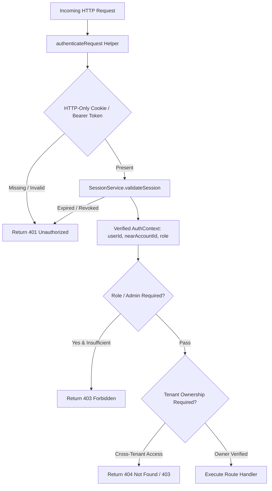

# MANDATE — MILESTONE 9.5: STAGE 3 BASELINE AUDIT
**Centralized Authentication, Authorization & Multi-Tenant Security Baseline**
**Document ID:** `docs/milestones/MILESTONE_9_5_STAGE_3_BASELINE.md`  
**Audit Date:** 2026-11-03  
**Auditor:** Senior Application Security & Distributed Systems Architect (Antigravity)  
**Status:** BASELINE AUDIT COMPLETE — AWAITING REMEDIATION COMMENCEMENT

---

## 1. EXECUTIVE SUMMARY & OBJECTIVE

Stage 2 successfully established production environment validation, eliminated hardcoded secret fallbacks, and validated the PostgreSQL database schema.

Stage 3 focuses on the primary application security perimeter: **Authentication, Authorization, and Tenant Isolation**.

The core security principle of Mandate is:
> **"A client-supplied identity is never proof of authorization. Every protected operation must derive its identity from cryptographically verified server-side credentials."**

This baseline audit evaluates the existing authentication mechanisms, identifies critical vulnerabilities (including authentication bypass, mass assignment, and IDOR across all 138 API routes), catalogs administrative gaps, and defines the remediation architecture.

---

## 2. EXISTING AUTHENTICATION ARCHITECTURE AUDIT

An architectural inspection was conducted across `src/lib/auth.ts`, `src/app/api/auth/route.ts`, `prisma/schema.prisma`, and all API route handlers.

### 2.1 Current Identity Sources & Verification Mechanisms
1. **Wallet Connection (`POST /api/auth`)**:
   - Accepts `{ accountId }` in the request body.
   - Queries NEAR RPC to check if the account exists on-chain.
   - **Vulnerability:** **Zero cryptographic proof.** Generates and returns a valid `sessionToken` without verifying that the client holds the private key for `accountId`. Any caller can impersonate any NEAR account (e.g. `victim.testnet` or `admin.near`).
2. **Session Token Header (`x-session-token`)**:
   - Clients send `x-session-token: sess_<randomHex>`.
   - Looked up via `prisma.user.findUnique({ where: { sessionToken } })`.
   - **Vulnerabilities:**
     - Session tokens are stored unhashed and un-signed in the database.
     - No expiration timestamp exists on the `User` model; sessions never expire.
     - No HTTP-only cookie support (tokens are exposed to client JavaScript and browser storage).
3. **Wallet Account Header Fallback (`x-near-account`)**:
   - In `src/lib/auth.ts`, if `x-session-token` is omitted, the server checks `x-near-account: alice.testnet`.
   - **Vulnerability:** Unauthenticated header spoofing. Any HTTP client can set this header to access or auto-create account resources.
4. **Development Default (`near_user.near`)**:
   - In non-production environments, omitting all headers silently falls back to `"near_user.near"`.

---

## 3. CATALOG OF CRITICAL SECURITY VULNERABILITIES

### 3.1 VULN-01: Authentication Bypass via Unauthenticated Wallet Connect (CRITICAL)
- **Location:** `src/app/api/auth/route.ts:16-56`
- **Mechanism:** `POST /api/auth` takes `{ accountId }`, generates an `authChallenge` nonce, but immediately issues an active `sessionToken` without waiting for or verifying a cryptographic signature.
- **Impact:** Complete identity takeover of any registered account.

### 3.2 VULN-02: Privilege Escalation via Client-Supplied Role in Administrative Endpoints (CRITICAL)
- **Location:**
  - `src/app/api/operations/pause/route.ts`
  - `src/app/api/operations/resume/route.ts`
  - `src/app/api/operations/lockdown/route.ts`
  - `src/app/api/operations/maintenance/route.ts`
- **Mechanism:** Routes extract `const { actorId, actorRole } = await req.json()`. `ControlAuthorizationService.assertAuthorized({ actorRole, ... })` evaluates this client-supplied string.
- **Impact:** Any unauthenticated caller or normal tenant can submit `actorRole: "OWNER"` to trigger platform lockdown, pause financial operations, or enter maintenance mode.

### 3.3 VULN-03: Insecure Direct Object Reference (IDOR) Across Resource Routes (HIGH)
- **Locations:**
  - `src/app/api/agents/[id]/route.ts`
  - `src/app/api/mandates/[id]/route.ts`
  - `src/app/api/jobs/[id]/cancel/route.ts`
  - `src/app/api/approvals/route.ts`
  - `src/app/api/incidents/[id]/acknowledge/route.ts`
- **Mechanism:** Routes fetch resources by primary key `id` (e.g. `prisma.agent.findUnique({ where: { id } })`) without verifying `resource.userId === authenticatedUser.id`.
- **Impact:** User A can read, cancel, or modify User B's agents, spending mandates, and background jobs.

### 3.4 VULN-04: Unauthenticated Disaster Recovery Endpoints (HIGH)
- **Locations:**
  - `src/app/api/disaster-recovery/restore/route.ts`
  - `src/app/api/disaster-recovery/backups/route.ts`
  - `src/app/api/disaster-recovery/backups/[id]/route.ts`
- **Mechanism:** Routes do not invoke `getAuthenticatedUser(req)` or verify any administrative credentials before listing, creating, or triggering database restorations.
- **Impact:** Unauthenticated actors can view backup manifests or attempt restore operations.

### 3.5 VULN-05: Missing Session Expiration & Invalidation Lifecycle (MEDIUM)
- **Mechanism:** `sessionToken` is a permanent string on the `User` model without TTL or expiration enforcement. Logouts do not rotate session secrets or invalidate active bearer tokens.

---

## 4. ROUTE AUTHENTICATION & OWNERSHIP GAP AUDIT

Out of the 138 API routes in `src/app/api`:

| Route Category | Total Routes | Currently Calling `getAuthenticatedUser` | Enforcing Tenant Ownership | Notes / Gaps |
|:---|:---:|:---:|:---:|:---|
| **Agents & Executions** | 8 | 8 | Partial | IDOR on `[id]` paths; agent access not always tenant-scoped |
| **Objectives & Coordination** | 21 | 21 | High | Most coordination calls verify tenant; handoffs require audit |
| **Tools & Discovery** | 9 | 7 | Low | Public tool catalog is legitimate; invocation must check tenant |
| **Integrations & MCP** | 14 | 13 | High | Credential vault isolates credentials; OAuth callback needs CSRF state binding |
| **Governance & Policy** | 11 | 10 | Medium | Policies are scoped, but evaluation simulation must not leak tenant rules |
| **Wallets & Financial** | 10 | 10 | High | ExecutionBoundaryService enforces limits, but wallet funding/withdrawal must strictly verify ownership |
| **Jobs & Workers** | 11 | 9 | Medium | Worker management routes must be restricted to system/admin |
| **Observability & Metrics** | 8 | 8 | Low | In-memory metrics endpoints must require authenticated tenant or admin role |
| **Reconciliation & Incidents** | 18 | 18 | Partial | Incident operations must verify responder role and tenant ownership |
| **Operations & Resilience** | 14 | 0 | **ZERO** | Administrative control mutations accept client-supplied `actorRole` |
| **Disaster Recovery** | 3 | 0 | **ZERO** | Completely unauthenticated |
| **Public Health & Diagnostics**| 3 | 0 | N/A | `/api/health/live`, `/api/health/ready`, `/api/health` legitimately public |

---

## 5. RECOMMENDED MIGRATION & REMEDIATION ARCHITECTURE

### Module Blueprint:
1. **`src/lib/auth/sessionService.ts`**:
   - Cryptographically signed session tokens: `sess_<userId>_<nonce>_<expiresAt>.<hmacSignature>`.
   - Signed using `SESSION_SECRET` (from `environmentValidation`).
   - 24-hour expiration window; sliding renewal support.
   - Secure HTTP-only cookies (`mandate_session`) with `SameSite=Lax`, `HttpOnly`, `Secure` (in prod).
   - Instant revocation and session rotation on logout.
2. **`src/lib/auth/walletAuthService.ts`**:
   - NEP-413 / Ed25519 cryptographic challenge signing:
     - Step 1: `GET /api/auth/challenge?accountId=...` generates server-side nonce bound to account with 5-minute TTL.
     - Step 2: `POST /api/auth/verify` validates signature using NEAR RPC access key list and `nearApi.utils.PublicKey.from(pubKey).verify()`.
     - Step 3: Issues signed session cookie and token only upon verified signature.
3. **`src/lib/auth/authenticateRequest.ts`**:
   - Uniform extraction from cookie (`mandate_session`) or header (`x-session-token`, `Authorization: Bearer ...`).
   - Returns typed `AuthContext`: `{ userId, nearAccountId, role, sessionExpiresAt, isSuperAdmin }`.
   - Never trusts client-supplied `userId` or unauthenticated `x-near-account`.
4. **`src/lib/auth/tenantAccessService.ts`**:
   - Reusable ownership guards:
     - `requireTenantOwnership(model, resourceId, userId)`
     - `requireAdmin(authContext)`
     - `requireWalletOwnership(walletId, userId)`
     - `requireAgentOwnership(agentId, userId)`
5. **Route Remediation Plan**:
   - Secure all 14 operational and disaster recovery routes with `requireAdmin`.
   - Update resource detail routes (`[id]`) to use tenant-scoped database queries (`where: { id, userId }`).
   - Eliminate client-supplied `actorRole` and `actorId` parameters.

---
*Baseline complete. Proceeding to Phase 2: Centralized Session Architecture & Authentication Services.*

