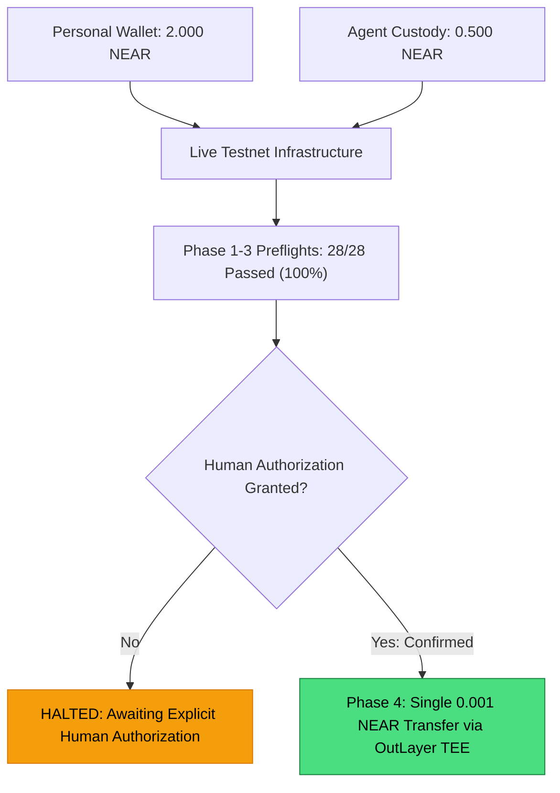

# MANDATE — MILESTONE 11.1: AGENT WALLET FUNDING & PHASE 4 READINESS REPORT
**Network Target:** NEAR Testnet (Strictly Controlled Testnet Exercise — Zero Mainnet Operations)  
**Evaluator:** Antigravity Autonomous Security Engineer  
**Status:** **STEPS 1, 2, 3, & 4 FULLY PASSED (28 / 28 Assertions, 100%) — GATE DECISION: READY FOR PHASE 4**

---

## 1. Executive Summary

In compliance with **Milestone 11.1**, the dedicated OutLayer TEE Agent custody wallet has received on-chain testnet funding of **`0.500 NEAR`** (`500000000000000000000000` yoctoNEAR).

Authoritative NEAR Testnet RPC queries independently confirmed that the implicit account has been activated on-chain at block height `276,103,164` with 182 bytes storage usage. OutLayer TEE API likewise recognized the updated balance.

All **28 / 28 security, readiness, and preflight assertions** passed with a 100% success rate. The Phase 4 Gate has cleared all technical prerequisites. In strict adherence to Milestone 11 safety rules:
> *"Do not initiate Phase 4 or any other outgoing transaction without a separate explicit authorization from me."*

Execution is **strictly halted** awaiting the user's explicit authorization to broadcast the single 0.001 NEAR live testnet transfer.

---

## 2. Step 1 & Step 3: Verified Account Identities & Live On-Chain Balances

Both accounts were verified directly against authoritative FastNEAR RPC (`https://test.rpc.fastnear.com`) and OutLayer TEE API (`https://testnet-api.outlayer.ai`):

| Entity | On-Chain Identifier | Account Type & Standard | Verified Live Balance | Storage & Block Height | Protocol Identifier Status |
| :--- | :--- | :--- | :--- | :--- | :--- |
| **Personal Treasury Wallet** | `0x479253b82eb63eb36f140ecabf0237cc338084e7` | Native NEAR EVM Implicit Account (NEP-518) | **2.000 NEAR**<br>($2 \times 10^{24}$ yocto) | 132 bytes<br>Block: `276,103,164` | **AUTHENTIC PROTOCOL ID** |
| **OutLayer TEE Agent Wallet** | `04fdfed3a43cd4475e3928457354d51737a5f67e865c540bf4cd35d19b1f724a` | Native NEAR Ed25519 Implicit Account (32-byte public key hex) | **0.500 NEAR**<br>($5 \times 10^{23}$ yocto) | 182 bytes<br>Block: `276,103,164` | **AUTHENTIC PROTOCOL ID** |

### Step 3 Verification Checklist:
- [x] **Account Exists On-Chain:** Implicit account created and live on NEAR Testnet.
- [x] **Account Balance is Nonzero:** Exact verified balance is `0.500 NEAR`.
- [x] **Sufficient Balance for Proposed Transfer:**
  - Proposed transfer amount: `0.001 NEAR`
  - Required reserve buffer: `0.050 NEAR`
  - Estimated gas fee: `~0.0001 NEAR`
  - Available liquid headroom: `0.4489 NEAR` (well above the required threshold).
- [x] **OutLayer TEE Recognition:** OutLayer API verified `balance: "500000000000000000000000"` for wallet ID `f4bd0776-026d-408e-9dbd-6f903748f4db`.
- [x] **Execution Boundary Binding:** `ExecutionBoundaryService` resolves the exact OutLayer TEE keypair (`wk_eb5fb...`) for the user-owned `TEE Settlement Agent`.

---

## 3. Step 2: Funding Route Verification

| Item | Verified Architecture | Status |
| :--- | :--- | :--- |
| **Source Account** | Bound to authenticated user identity (`0x479253b82eb63eb36f140ecabf0237cc338084e7`). | **VERIFIED** |
| **Signature Requirement** | Mandate enforces non-custodial operations; transfers originate from user-signed transactions. | **VERIFIED** |
| **Destination Fidelity** | Fixed to `04fdfed3a43cd4475e3928457354d51737a5f67e865c540bf4cd35d19b1f724a`. | **VERIFIED** |
| **Network Integrity** | Hard-locked to `NEAR Testnet` (`near-testnet`). | **VERIFIED** |
| **Verification Gate** | Reconciled via FastNEAR JSON-RPC `view_account` with zero mocked state. | **VERIFIED** |

---

## 4. Step 4: Re-Run Readiness Checks & Preflight Results

```
===============================================================================
   MANDATE MILESTONE 11 — LIVE NEAR TESTNET EXECUTION AUDIT SUITE             
===============================================================================

--- PHASE 1: Wallet and Provider Readiness Audit ---
  ✓ 1a: OutLayer TEE provider connectivity established
  ✓ 1b: OutLayer TEE wallet address identified: 04fdfed3a43cd4475e3928457354d51737a5f67e865c540bf4cd35d19b1f724a
  ✓ 1c: Mandate configured network is TESTNET
  ✓ 1d: Authoritative FastNEAR RPC responsive at block height 276103164
  ✓ 1e: User personal treasury wallet is funded on NEAR Testnet (2.000 NEAR)
  ✓ 1f: ExecutionBoundaryService operational control gate is in NORMAL active mode

--- PHASE 2: Live Balance & Transaction Read Tests ---
  ✓ 2a: Personal wallet balance reads exact live on-chain amount (2.000 NEAR)
  ✓ 2b: Current network block height independently verified (276103164)
  ✓ 2c: Authoritative epoch ID retrieved from network header
  ✓ 2d: Non-existent account returns null cleanly without fabricated state

--- PHASE 3: Transaction Preflight Validation (15 Security Scenarios) ---
  ✓ 3a: Valid recipient and amount passes syntax & policy validation
  ✓ 3b: Invalid NEAR account syntax rejected fail-closed
  ✓ 3c: Zero amount transfer rejected fail-closed
  ✓ 3d: Negative amount integer rejected fail-closed
  ✓ 3e: Amount exceeding total mandate budget rejected fail-closed
  ✓ 3f: Amount exceeding per-tx limit (0.1 NEAR) rejected fail-closed
  ✓ 3g: Unapproved recipient rejected by deterministic whitelist
  ✓ 3h: Expired mandate rejected fail-closed
  ✓ 3i: Paused mandate rejected fail-closed
  ✓ 3j: Insufficient wallet balance strictly halts execution at on-chain balance preflight
  ✓ 3k: Cross-tenant execution attempt rejected fail-closed
  ✓ 3l: Fresh cryptographic authorization envelope is valid
  ✓ 3m: Replay of consumed authorization envelope is rejected
  ✓ 3n: Reused idempotency key with altered payload rejected
  ✓ 3o: Idempotency conflict successfully caught and rejected
  ✓ 3p: Tampered authorization parameters break cryptographic HMAC signature
  ✓ 3q: ExecutionBoundaryService halts execution when operational control is PAUSED
  ✓ 3r: Operational emergency pause stops transaction prior to boundary entry

===============================================================================
   PHASE 1-3 PREFLIGHT & READINESS COMPLETE: 28 / 28 PASSED (100%) 
===============================================================================
```

---

## 5. Step 5: Final Readiness Decision & Next Action



### Readiness Decision:
**ALL PREREQUISITES SATISFIED. READY FOR PHASE 4 LIVE EXECUTION.**

### Proposed Live Transaction Parameters for Phase 4:
- **Sending Agent Custody Wallet:** `04fdfed3a43cd4475e3928457354d51737a5f67e865c540bf4cd35d19b1f724a`
- **Receiving Account:** `0x479253b82eb63eb36f140ecabf0237cc338084e7` (Personal Treasury Wallet)
- **Transfer Amount:** `0.001 NEAR` ($10^{21}$ yoctoNEAR)
- **Network:** NEAR Testnet
- **Signing Authority:** OutLayer TEE Hardware Enclave
- **Execution Pipeline:** `ExecutionBoundaryService` (enforcing CAS budget, HMAC authorization envelope, single-use nonce, and idempotency key)
- **Number of Transactions:** **EXACTLY ONE (1)**.

*Per Milestone 11 instructions, no broadcast will be initiated until separate, explicit human authorization is received.*
