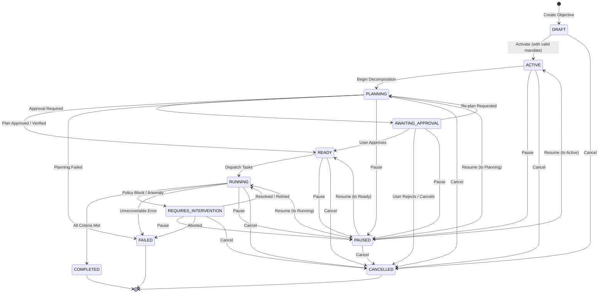

# MANDATE — MILESTONE 13.1
## ARCHITECTURE DISCOVERY REPORT: OBJECTIVE LIFECYCLE & EXECUTION FOUNDATION

**Date:** November 3, 2026  
**Scope:** Repository Discovery for Milestone 13.1  
**Target:** Objective models, lifecycle state machine, mandate binding, tenant authorization, API routes, and UI.

---

### 1. REUSABLE ASSETS

| System / Component | File Location | Reusable Capabilities |
| :--- | :--- | :--- |
| **Objective Interpreter** | `src/lib/objectives/interpreter.ts` | Natural language goal decomposition, requirement parsing, structured goal extraction (`StructuredGoal`). |
| **Criteria Evaluator** | `src/lib/objectives/criteriaEvaluator.ts` | Deterministic verification of success criteria (`NUMERIC`, `BOOLEAN`, `ON_CHAIN_VERIFICATION`, `TOOL_RESULT`). |
| **Objective Authority** | `src/lib/objectives/authority.ts` | Mandate allowlist matching, available budget calculation, expiration checks. |
| **Event Stream & Audit Dual-Dispatch**| `src/lib/objectives/events.ts` | Dual-dispatching objective events to both `ObjectiveEvent` and the tamper-evident SHA-256 cryptographic audit ledger (`recordAuditEvent`). |
| **Execution Orchestrator** | `src/lib/runtime/orchestrator.ts` | Agent task execution and coordination graph. |
| **Execution Boundary Service** | `src/lib/execution/boundaryService.ts` | Hardware TEE execution, authorization envelope validation, idempotency, and settlement. |
| **Mandate Accounting Service** | `src/lib/mandate/accountingService.ts` | BigInt yoctoNEAR atomic reservation, CAS versioning, available budget invariant calculation. |
| **Tenant Session Auth** | `src/lib/auth.ts` | `getAuthenticatedUser(req)`, cookie/header-based session validation. |

---

### 2. GAPS & INCOMPLETE CAPABILITIES

1. **Objective Lifecycle State Machine Incomplete:**
   - Previous implementation used an informal 10-status set (`DRAFT`, `NEEDS_CLARIFICATION`, `AWAITING_USER_APPROVAL`, `ACTIVE`, `PAUSED`, `BLOCKED`, `COMPLETED`, `FAILED`, `CANCELLED`, `ARCHIVED`).
   - Milestone 13.1 mandates an explicit 11-status lifecycle:
     `DRAFT`, `ACTIVE`, `PLANNING`, `READY`, `RUNNING`, `AWAITING_APPROVAL`, `PAUSED`, `COMPLETED`, `FAILED`, `CANCELLED`, `REQUIRES_INTERVENTION`.
   - Transitions were executed via ad-hoc `prisma.objective.update` without atomic Compare-And-Swap (CAS) version checks, creating race conditions under concurrent updates.

2. **Objective Data Model Missing Versioning and Execution Attributes:**
   - `model Objective` lacks an integer `version` field for optimistic concurrency control.
   - Missing explicit fields: `planningStatus`, `executionStatus`, `completionEvidenceJson`, `failureReason`, and `deadlineAt`.
   - `constraintsJson` stored budget in floating-point `maxNear`, risking rounding errors. Must support integer yoctoNEAR string `maxBudgetYocto`.

3. **Mandate Authority Lacked Strict Lifecycle Coupling:**
   - Objectives could reference mandates without enforcing that the mandate remains `ACTIVE` throughout the objective's lifecycle.
   - No check preventing an objective from expanding beyond the mandate's unreserved available budget.

4. **Missing Dedicated Lifecycle API Endpoints:**
   - `POST /api/objectives/[id]/activate` was missing.
   - Endpoint status updates lacked explicit actor identification, optimistic version checks, and uniform 404 tenant masking.

5. **Customer UI Status Mapping:**
   - `src/app/objectives/page.tsx` and `src/app/objectives/[id]/page.tsx` mapped only legacy statuses and lacked lifecycle transition controls (e.g. Activate, Pause, Resume, Cancel) tied to authorized roles.

---

### 3. REQUIRED ARCHITECTURAL CHANGES (MILESTONE 13.1)

1. **Schema Extension:** Add `version`, `planningStatus`, `executionStatus`, `completionEvidenceJson`, `failureReason`, and `deadlineAt` to `model Objective`. Add transition metadata to `model ObjectiveEvent`.
2. **Deterministic Lifecycle Service:** Create `ObjectiveLifecycleService` in `src/lib/objectives/lifecycleService.ts` with CAS `$transaction` guarantees and strict transition table enforcement.
3. **Mandate Binding & Accounting Preservation:** Reuse Milestone 12's `MandateAccountingService` without creating separate objective balances.
4. **Tenant Security:** Mask all unauthorized/cross-tenant access attempts with HTTP 404.
5. **UI & API Alignment:** Implement `/activate`, `/pause`, `/resume`, `/cancel` with real-time state synchronization.

